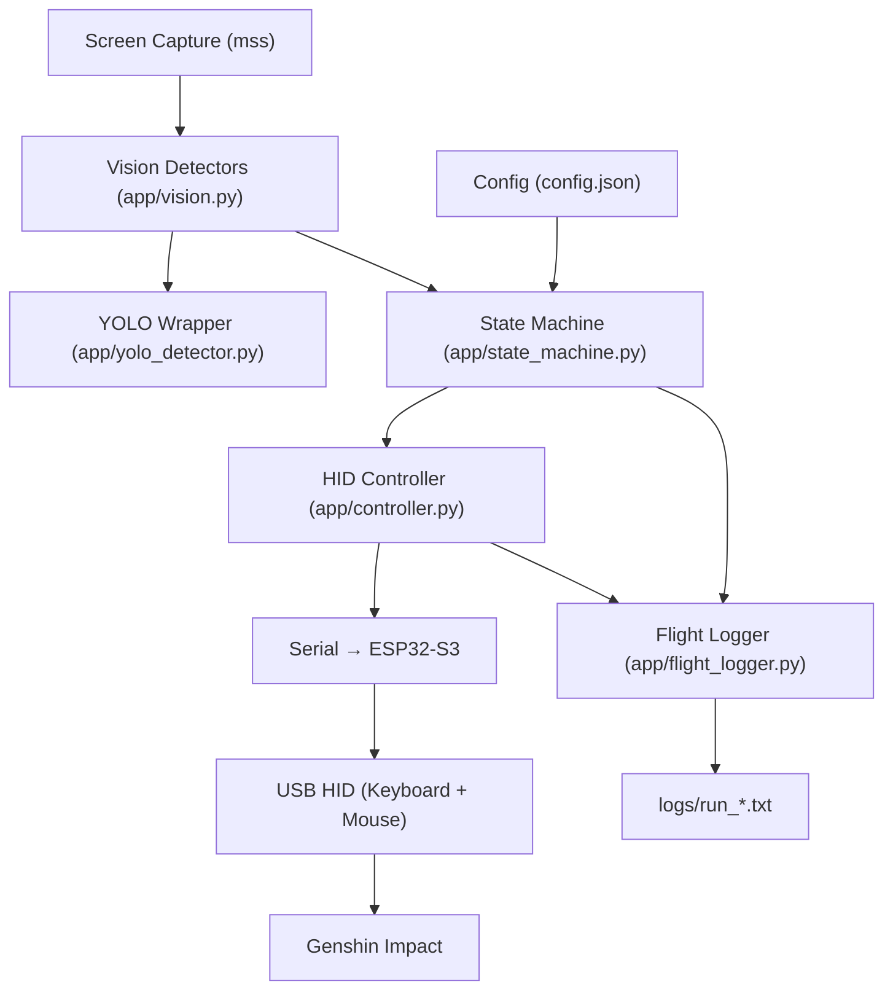
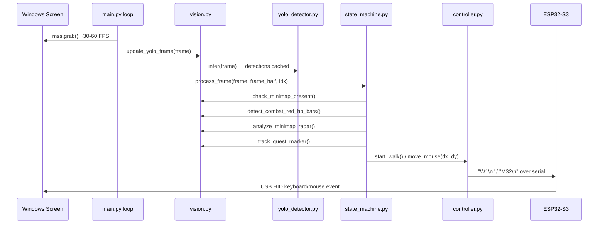

# Engineering Handoff: `genshin_cv_hid`

> **Repository:** https://github.com/Bekhzod1005/genshin_cv_hid  
> **Latest commit:** `2e740b3`  
> **Python:** 3.13+ (venv at `venv/`)  
> **Platform:** Windows 11, 1280×720 Genshin Impact client  
> **Hardware:** ESP32-S3 DevKit connected via USB-OTG (native HID)

---

## 1. What This Project Does

`genshin_cv_hid` is a **hardware-assisted computer-vision automation assistant** for the PC game *Genshin Impact*. It is **not a software bot** — it uses an ESP32-S3 microcontroller as a **real USB HID keyboard and mouse**, so from Windows' perspective all inputs are physically typed/clicked by a human. The Python host does the vision and decision-making; the ESP32 does the actual key pressing.

### Core Loop

```
Screen → mss capture → OpenCV/YOLO detectors → State Machine → Serial Commands → ESP32-S3 → USB HID → Game
```

The automation handles four states in strict priority order:

| Priority | State | Trigger | Action |
|---|---|---|---|
| 1 | **DIALOGUE** | Minimap hidden | Advance dialogue, choose options |
| 2 | **COMBAT_AUTO** | ≥2 consecutive valid enemy HP bars | Melee combos, skill/burst, Amber bow aim shots |
| 3 | **CHEST_LOOT** | Hollow-ring sealed chest + ≥4 consecutive frames | Walk toward chest, loot vacuum |
| 4 | **NAVIGATE** | Default | Walk toward quest diamond via 2D minimap radar |

---

## 2. Full Architecture



### Navigation Sub-Architecture (the most complex piece)

Navigation uses a **2-sensor priority hierarchy**:

1. **Primary: 2D Minimap Radar** (`analyze_minimap_radar`) — reads gold/blue quest blips and the golden breadcrumb `V`-trail from the top-left minimap circle. Steers using **one-shot calibrated yaw pulses** (counts-per-degree empirically measured against the minimap player arrow).

2. **Terminal (last ~12 m): Hybrid 3D Quest Diamond Tracking** — template matching (18×18 center-cropped PNG) + direct HSV+dark-outline detector, used only when `objective_dist_px ≤ 26 px` on the minimap.

3. **Fallback: Minimap Pivot** — when both 3D and radar are lost, the old `analyze_minimap_road_and_quest` bearing drives a proportional pivot turn.

Navigation mode cycles between **ALIGN** (stationary camera centering) and **CRUISE_LOCKED** (walk forward, camera locked, no mouse panning).

---

## 3. File-by-File Reference

### `firmware/esp32s3_hid/esp32s3_hid.ino`
**What it is:** Arduino sketch for the ESP32-S3 running TinyUSB HID.

**What it does:**
- Presents itself to Windows as a USB keyboard + mouse
- Receives newline-terminated ASCII commands over `Serial` at 115200 baud (`Serial.setRxBufferSize(512)`)
- Non-blocking key/mouse scheduler (`tapQueue[MAX_TAPS=6]`, `millis()`-based release table)
- Micro-stepped smooth mouse movement: chunks ≤16 counts, 900 µs spacing, clamped to ±110
- Decoupled hold states: `W0` only releases `'w'`; `LMB_REL` only releases left mouse button
- 12-second safety watchdog: if host stops sending and keys are held, releases all inputs

**Commands:**
```
PING → PONG
W1 / W0           → hold/release 'w'
LMB / LMB_HOLD / LMB_REL  → click/hold/release left mouse
RMB               → right mouse click
F / V / E / Q / R / SPACE → key taps (randomized hold 48–112 ms)
1 / 2 / 3 / 4    → character slot keys
M<dx>             → horizontal mouse move
M<dx>,<dy>        → 2-axis mouse move
STOP              → emergency release all
```

**Known issue:** `moveMouseSmooth` still uses `delayMicroseconds(900)` between micro-steps, which blocks the serial read loop for up to `~900 µs × (totalDx/16)` per move command. For typical steering values (dx ≤ 95) this is at most ~5.4 ms and is acceptable, but it is a soft blocking call.

---

### `app/config_manager.py`
**What it is:** Central constants, configuration loading, and utility functions.

**What it exports:**
- All ROI definitions (`ROI_NAV`, `ROI_COMBAT`, `ROI_MINIMAP`, etc.) as `(y1, y2, x1, x2)` tuples in 1280×720 space
- `MINIMAP_CENTER = (114, 96)`, `MINIMAP_RADIUS = 68`
- `HARDCODED_DEFAULTS` dict — the single source of truth for all tunable parameters
- `load_config()` / `save_config()` — JSON persistence with defaults fallback
- `setup_dpi_awareness()` — Windows DPI fix (call once at startup)
- `play_alert_chime()` — non-blocking beep on combat manual timeout
- `human_delay()` / `dialogue_advance_delay()` — log-normal humanized timing

**Key tunable parameters in `HARDCODED_DEFAULTS`:**

| Key | Default | Purpose |
|---|---|---|
| `Kp_fine` | 0.16 | PD proportional gain, Zone 2 (fine tracking) |
| `Kp_fast` | 0.26 | PD proportional gain, Zone 3 (fast turn) |
| `Kd` | 0.06 | PD derivative gain |
| `center_lock_deadzone` | 24 px | Error below which dx = 0 (hard lock) |
| `cruise_drift_corridor` | 95 px | Error above which CRUISE_LOCKED → ALIGN |
| `pivot_error_threshold` | 115 px | Error above which walking pauses |
| `default_pitch_up_counts` | -30 | Camera upward tilt on NAVIGATE entry |
| `counts_per_degree` | 0.65 | Mouse counts per degree of camera yaw (auto-calibrated) |
| `yaw_calibrated` | false | Whether auto-calibration has run |
| `template_match_threshold` | 0.50 | Minimum NCC score for template match |
| `quest_v_pulse_cooldown` | 5.0 s | Minimum interval between V key pulses |

---

### `app/controller.py`
**What it is:** Python-side HID command layer and PD steering controller.

**`ESP32HIDController`:**
- Owns the `serial.Serial` connection
- Thin wrapper methods: `start_walk()`, `stop_walk()`, `move_mouse(dx, dy)`, `press_f()`, etc.
- Tracks `is_walking` and `is_lmb_held` state client-side to avoid duplicate commands
- Sends keepalive `W1` if no command for 4.0 s while walking (prevents firmware watchdog)
- Thread-safe via `threading.Lock()` on serial writes
- Falls back to `dry_run=True` if serial fails

**`PDSteeringController`:**
- Two-zone PD: Zone 2 (`|err| ≤ 130 px`, dx clamped ±28), Zone 3 (`|err| > 130`, dx clamped ±52)
- Derivative is EMA-smoothed: `filtered_d = 0.75 × prev_d + 0.25 × raw_d`
- Rate-limited to `steer_rate_hz` (default 20 Hz) — returns `(0, pause_walk)` during dead time
- `compute_minimap_pivot(bearing_rad)` — pivot-in-place toward minimap bearing (clamped ±48)

---

### `app/vision.py`
**What it is:** All OpenCV computer vision detectors. The largest file (~1000 lines).

**`VisionDetector` class — public methods:**

| Method | Input | Output | Notes |
|---|---|---|---|
| `get_minimap_player_yaw(frame)` | BGR frame | `float` degrees or `None` | Segments white/cyan arrow (`S≤75, V≥215`) in r≤16 px disk; `cv2.fitLine` + 180° ambiguity resolution |
| `analyze_minimap_radar(frame)` | BGR frame | dict | Gold/blue blips, V-trail, bearing fusion. **Primary nav sensor.** |
| `analyze_minimap_road_and_quest(frame)` | BGR frame | tuple | Legacy Gold-only bearing + road segmentation. Used as fallback. |
| `track_quest_marker(frame, config, idx, last_lock)` | BGR frame | `(centroid, type, bbox, score, label)` | Multi-scale template + direct HSV detector. 120×120 local search when locked. |
| `detect_combat_red_hp_bars(frame)` | BGR frame | `(found, count, area, centroid, elevated, bbox)` | Strict geometry: width 34–140, height 3–10, aspect ≥5.5, extent ≥0.65 |
| `detect_sealed_chest_ring(frame_half)` | 640×360 frame | `(found, bbox, centroid)` | Hollow-ring check: fill extent 0.12–0.48 |
| `detect_overworld_f_prompt(frame)` | BGR frame | `(found, bbox)` | Keycap + dark pill strip dual-check |
| `check_choice_icon(frame)` | BGR frame | `(found, bbox)` | White blob + optional template match |
| `detect_party_size(frame)` | BGR frame | `int` 1–4 | HP bar + edge density per portrait slot |
| `update_yolo_frame(frame)` | BGR frame | — | Runs YOLO inference, caches `latest_yolo_detections` |
| `reload_templates()` | — | — | Re-reads PNG assets from disk without overwriting |

**YOLO priority:** Most detectors check `self.latest_yolo_detections` first and fall back to OpenCV only if YOLO is unavailable or returns nothing.

**Template loading:** `quest_gold.png` and `quest_blue.png` are center-cropped to 18×18 on load (stripping outer background corners of the 28×28 source image).

---

### `app/yolo_detector.py`
**What it is:** ONNX Runtime wrapper for YOLOv8n inference on Intel Arc GPU via DirectML.

**`YoloUIWrapper` class:**
- Loads `assets/genshin_yolov8n.onnx` using `onnxruntime` with provider priority: `DmlExecutionProvider` → `OpenVINOExecutionProvider` → `CPUExecutionProvider`
- Preprocesses 1280×720 BGR → 640×640 RGB float32 blob
- Handles both output shapes: `(1, 9, 8400)` and `(1, 8400, 9)` (pre/post transpose)
- NMS via `cv2.dnn.NMSBoxes` (conf=0.35, IoU=0.45)
- Filter helpers: `get_quest_marker()`, `get_f_prompt()`, `get_enemy_hp_bars()`, `get_dialogue_choices()`
- `draw_detections()` for debug overlay

**5 detected classes:** `quest_gold` (0), `quest_blue` (1), `f_prompt` (2), `enemy_hp` (3), `dialogue_choice` (4)

**Note:** The model at `assets/genshin_yolov8n.onnx` was trained on **synthetic** data only. Real-game accuracy is currently limited by this.

---

### `app/state_machine.py`
**What it is:** The main decision-making brain. The largest file (~1125 lines).

**`AssistantStateMachine` class — key sections:**

**Initialization:** Sets up all state variables. `needs_pitch_reset = True` by default so the camera tilts up on first NAVIGATE entry (Mondstadt elevation compensation).

**`process_frame(frame, frame_half, frame_idx)`:** Called every frame. Runs the 4-level priority hierarchy — returns early at the first active level.

**`calibrate_yaw(frame, wait_func, next_frame)`:** Synchronous calibration. Reads `yaw_0`, sends `M45,0`, waits 0.18 s, reads `yaw_1`, computes `counts_per_degree = 45.0 / |delta_deg|` clamped to [0.30, 1.80]. Also implemented inline in `_execute_navigate_step` as a non-blocking 2-phase state machine (`START` → `WAIT_SETTLE`).

**`_execute_navigate_step`:** The most complex method (~450 lines). Flow:
1. Post-dialogue V pulse
2. Camera pitch reset
3. Yaw calibration (non-blocking)
4. Overworld [F] prompt arbitration (Situation A: post-combat drops → vacuum; Situation B: quest arrival → single F tap; else: ignore NPC)
5. Ground motion differencing + staged unstuck (0.8 s SPACE hop → 1.7 s lateral turn + hop)
6. **2D Minimap Radar navigation** (primary sensor)
7. **Terminal 3D diamond tracking** (demoted, used only when `obj_dist_px ≤ 26 px`)
8. CRUISE_LOCKED / ALIGN hysteresis state machine
9. Lost-marker 4-phase recovery (IDLE → WAIT_INITIAL → WAIT_V_PULSE → STEP_SWEEP → SWEEP_COMPLETE)

**`_execute_auto_combat_step`:** Non-blocking Amber bow aim-shot state machine (AIM_IDLE → AIM_SWAP_WAIT → AIM_ENTER_R → AIM_TRACK_AND_CHARGE → AIM_RELEASE), plus melee combos, skill/burst scheduling.

**`_execute_loot_vacuum_step`:** Phased loot sequence (WAIT_ANIMATION → BURST with wiggle → DRAIN_PROMPT).

---

### `app/flight_logger.py`
**What it is:** Thread-safe, line-buffered telemetry logger.

- Opens `logs/run_YYYYMMDD_HHMMSS.txt` at startup (`buffering=1` for real-time trace)
- Format: `[+004.125s] [TAG] message`
- Tags: `BOOT`, `FOCUS`, `STATE`, `NAV`, `VISION`, `CALIB`, `YOLO`, `UNSTUCK`, `HID`, `TELEM`, `PAUSE`
- 4 Hz `[TELEM]` heartbeat: state, nav_mode, walking, minimap score, marker, bearing, trail_bearing, counts_per_deg, f_prompt, motion score
- Context manager support (`with FlightLogger() as log:`)

---

### `app/main.py`
**What it is:** Application entry point, screen capture loop, debug window, and hotkey handling.

**`GenshinAssistantApp` class:**
- Owns `FlightLogger`, `ESP32HIDController`, `VisionDetector`, `AssistantStateMachine`
- Main loop: window discovery → screen capture → focus check → state machine → debug render
- mss screen capture with Genshin client rect detection; falls back to monitor 1 if window not found
- Debug window renders at ≤20 FPS: ROI overlays, YOLO boxes, quest reticle, HP bar, telemetry banner, hotkey bar

**Hotkeys (OpenCV window focused):**
| Key | Action |
|---|---|
| `F12` | Global pause/resume (pynput global listener, works from any window) |
| `C` | Trigger yaw calibration |
| `T` | Capture 28×28 template at tracked marker centroid |
| `D` | Reset config to HARDCODED_DEFAULTS |
| `S` | Save active config to config.json |
| `Q` / ESC | Clean shutdown |
| Left-click on debug window | Crop 28×28 at click position, auto-detect gold/blue by center HSV |

**CLI flags:**
```
python app/main.py --port COM4     # serial port (default COM4)
python app/main.py --dry-run       # no serial, visual only
python app/main.py --collect-bg    # capture 150 frames to dataset/backgrounds/ and exit
```

---

### `tools/auto_train_yolo.py`
**What it is:** Fully self-contained synthetic dataset generator + YOLOv8n trainer + ONNX exporter.

**Pipeline:**
1. `load_or_generate_sprites()` — loads user PNGs or programmatically generates RGBA sprites for all 5 classes
2. `get_or_generate_backgrounds()` — loads from `dataset/backgrounds/` or synthesizes Mondstadt-palette gradient scenes
3. `generate_synthetic_dataset()` — composites 1–4 sprites per 640×640 patch with scale/brightness/blur jitter; writes YOLO labels
4. `train_and_export_yolo()` — calls `ultralytics.YOLO("yolov8n.pt").train(...)`, then `.export(format="onnx", opset=12, simplify=True)`; copies to `assets/genshin_yolov8n.onnx`

```bash
python tools/auto_train_yolo.py --epochs 35 --num-images 1500
python tools/auto_train_yolo.py --generate-only
python tools/auto_train_yolo.py --train-only --output-onnx assets/genshin_yolov8n.onnx
```

---

### `app/test_hid.py`
Unit tests for `ESP32HIDController` using a mock serial port. Tests: command formatting, walk state tracking, LMB hold/release decoupling, mouse clamping.

### `config.json`
Active configuration file. Merged with `HARDCODED_DEFAULTS` on load (file wins). Modified in-place by `[S]` save and yaw calibration. Committed to repo with factory defaults.

### `requirements.txt`
```
mss>=9.0.1
opencv-python>=4.8.0
numpy>=1.24.0
pyserial>=3.5
pynput>=1.7.6
pywin32>=306
ultralytics>=8.0.0
onnx>=1.14.0
onnxruntime-directml>=1.15.0
```

### `assets/`
| File | Description |
|---|---|
| `quest_gold.png` | 28×28 user-captured gold quest diamond template. **Do not overwrite programmatically.** |
| `quest_blue.png` | 28×28 user-captured blue quest diamond template. **Do not overwrite programmatically.** |
| `genshin_yolov8n.onnx` | Trained YOLOv8n model (12.2 MB). Currently synthetic-data only. |
| `minimap_border.png` | Optional minimap border template for `check_minimap_present` (not required). |
| `choice_icon.png` | Optional dialogue choice icon template (not required). |

---

## 4. Data Flow Diagram



---

## 5. What Works Well

- **ESP32 firmware** is solid: non-blocking, watchdog-protected, correctly decoupled hold states
- **Combat detection** (strict HP bar geometry) is essentially false-positive-free in practice
- **Dialogue handling** (minimap-hidden trigger + choice arbitration) is reliable
- **Loot vacuum** sequence is well-tested
- **Flight logger** produces clean traces for post-run debugging
- **Template system** is robust — user can click to capture a new template at any time
- **Safety guards** — F12 pause, foreground window check, firmware watchdog — are thorough

---

## 6. Known Issues & Areas for Improvement

### 🔴 High Priority

#### 6.1 YOLO Model Is Synthetic-Only
The shipped `genshin_yolov8n.onnx` was trained entirely on composited synthetic data. It has poor recall on real in-game frames, especially in varied lighting. The OpenCV fallback detectors carry most of the load.

**What to do:**
1. Run `python app/main.py --collect-bg` to gather 150 real gameplay frames
2. Run `python tools/auto_train_yolo.py` — it will blend real backgrounds with sprites
3. Optionally: use Roboflow or LabelImg to hand-label a few hundred real frames of quest diamonds and HP bars to supplement. Even 200 real labels dramatically improve detection.
4. Retrain and re-export. The pipeline is already set up — just needs real data.

#### 6.2 Minimap Blip HSV Ranges Are Empirically Fragile
The gold blip range (`H: 19–35, S: 175–255, V: 205–255`) and blue blip range (`H: 94–116, S: 140–255, V: 195–255`) in `analyze_minimap_radar` were calibrated for a specific in-game time of day and weather. At night or in foggy weather these will miss.

**What to do:** Add an adaptive saturation/value fallback with slightly wider ranges; or add a time-of-day detector that selects a tighter or wider HSV preset.

#### 6.3 Navigation Sensor Fusion Gap
When radar reports `steering_source = "NONE"` (no blip, no trail) and the 3D marker is also absent, the system enters the 4-phase lost-marker sweep. The sweep is non-endless but takes ~5–8 seconds and can spin the character in the wrong direction.

**What to do:** When radar has `player_yaw_deg` but no objective, consider using `player_yaw_deg` to maintain the last-known heading rather than immediately sweeping. Add a `"HOLD_HEADING"` phase before sweeping.

---

### 🟡 Medium Priority

#### 6.4 `moveMouseSmooth` Soft-Blocks Serial Loop
In the firmware, `moveMouseSmooth` uses `delayMicroseconds(900)` between 16-count steps. For large steering commands (dx = 95), this takes ~5.4 ms during which no serial bytes are read. Under sustained high-frequency mouse steering, incoming commands may queue in the 512-byte RX buffer.

**What to do:** Replace with a true non-blocking step scheduler (additional `millis()`-tracked mouse step queue) similar to the existing `tapQueue`. This would fully eliminate the last blocking call in the firmware loop.

#### 6.5 Yaw Calibration Uses `time.sleep(0.18)` in Synchronous Path
The `calibrate_yaw()` standalone method (called by test scripts) uses `wait_func(0.18)` which defaults to `time.sleep`. The inline non-blocking version in `_execute_navigate_step` correctly returns across frames. The synchronous version is only used in tests but could cause frame drops if ever called directly from the loop.

**What to do:** Deprecate the synchronous `calibrate_yaw()` method; always go through the inline `calibration_phase` state machine.

#### 6.6 `app/__init__.py` Re-imports All Modules at Package Load
Even after the circular import fix, `import app` still imports `VisionDetector` (which runs `YoloUIWrapper.__init__` → loads the 12 MB ONNX model) and `ESP32HIDController` (which opens a serial port). This makes `import app` from test scripts slow and side-effectful.

**What to do:** Empty `__init__.py` or move to explicit `from app.vision import VisionDetector` style imports in tests. The package doesn't need to eagerly initialize everything.

#### 6.7 No Anti-Detection / Rate Limiting on Serial Commands
The state machine can fire mouse move commands at 20 Hz (rate-limited by `PDSteeringController`) but nothing rate-limits the HID events from the game's perspective. Modern anti-cheat (MiHoYo uses a modified kernel driver) primarily looks for behavioral patterns, not raw HID rates — but the existing randomized delays in the firmware help.

**What to do:** Already reasonably addressed by `human_delay()`, randomized combat timings, and log-normal delays. No immediate action needed but keep in mind for future refinement.

---

### 🟢 Low Priority / Nice to Have

#### 6.8 No Obstacle/Cliff Avoidance
If the navigation path leads toward water or a cliff edge, the bot will walk off. The unstuck motion detector (`smooth_motion_score`) catches "stuck against a wall" but not "fell off edge."

**What to do:** Add a ground-normal detector using the bottom portion of the frame — if the horizon line suddenly disappears (player is falling), trigger an emergency SPACE + backward turn.

#### 6.9 Single Monitor Assumption
`find_genshin_window()` calls `GetClientRect` correctly, but the fallback path (`sct.monitors[1]`) captures the entire primary monitor. On multi-monitor setups where Genshin is on monitor 2, the fallback will capture the wrong screen.

**What to do:** Enumerate monitors and select the one containing the Genshin window rect. `mss` supports `sct.monitors[n]` for multi-monitor.

#### 6.10 `detect_party_size` Is Conservative
The party size detector checks HP bars on the right portrait strip using fixed pixel offsets (`1145:1245`). These offsets are correct for 1280×720 but break on other resolutions. It currently only counts up to 4 and stops at the first "empty" slot, so a party like [Lumine, None, Fischl, Bennett] would report size=1.

**What to do:** Scan all 4 slots independently rather than breaking on the first gap; handle sparse parties.

#### 6.11 `auto_train_yolo.py` Has No --imgsz Flag
The ONNX model is trained at 640×640 and exported at 640×640, but the game runs at 1280×720. The `YoloUIWrapper` resizes the frame to 640×640 (uniform scale, not letterboxed). This introduces 11% horizontal distortion.

**What to do:** Add proper letterbox preprocessing in `YoloUIWrapper.infer()` and inverse-letterbox the output bounding boxes. Or export the model at `imgsz=1280` (much larger but no distortion).

---

## 7. Where to Pick Up Work — Recommended Order

1. **Collect real data + retrain YOLO** (§6.1) — biggest impact, all infrastructure already in place
2. **Fix firmware `moveMouseSmooth` blocking** (§6.4) — small change, eliminates last blocking call
3. **Non-blocking yaw calibration cleanup** (§6.5) — deprecate `calibrate_yaw()`, use inline path everywhere
4. **Letterbox YOLO preprocessing** (§6.11) — fix coordinate distortion in `yolo_detector.py`
5. **Minimap HSV adaptive ranges** (§6.2) — add time-of-day HSV preset switching
6. **Hold-heading before sweep** (§6.3) — add `HOLD_HEADING` lost-marker phase

---

## 8. Environment Setup for a New Engineer

```powershell
# 1. Clone
git clone https://github.com/Bekhzod1005/genshin_cv_hid.git
cd genshin_cv_hid

# 2. Create venv and install
python -m venv venv
.\venv\Scripts\Activate.ps1
pip install -r requirements.txt

# 3. Flash ESP32-S3 firmware
# Open firmware/esp32s3_hid/esp32s3_hid.ino in Arduino IDE 2.x
# Board: "ESP32S3 Dev Module", USB Mode: "USB-OTG (TinyUSB)", USB CDC On Boot: Enabled
# Upload, then connect the OTG port to PC (use the USB-OTG port, not the UART port)

# 4. Verify serial handshake
python -c "import serial; s=serial.Serial('COM4',115200,timeout=1); s.write(b'PING\n'); print(s.readline())"
# Expected: b'PONG\n'

# 5. Collect real backgrounds (Genshin must be open and in focus)
python app/main.py --collect-bg

# 6. Train YOLO (optional — works with existing synthetic ONNX)
python tools/auto_train_yolo.py --epochs 35 --num-images 1500

# 7. Dry run (no ESP32 required)
python app/main.py --dry-run

# 8. Full run
python app/main.py --port COM4
```

**Key file locations:**
- Templates: `assets/quest_gold.png`, `assets/quest_blue.png` — capture in-game with `[T]` or left-click
- ONNX model: `assets/genshin_yolov8n.onnx`
- Config: `config.json` — press `[D]` to reset defaults, `[S]` to save
- Run logs: `logs/run_YYYYMMDD_HHMMSS.txt` — full telemetry trace per session

---

## 9. Key Design Decisions & Rationale

| Decision | Rationale |
|---|---|
| ESP32-S3 as HID device | No kernel driver needed; inputs are indistinguishable from physical hardware at the USB level |
| Minimap radar as primary nav (not 3D diamond) | The 3D diamond disappears at close range and is occluded by terrain. Minimap blip is always visible. |
| Template matching center-cropped to 18×18 | Strips out the outer background of the 28×28 user template, which varies by sky/terrain behind the diamond |
| Strict HP bar geometry (not just red pixels) | Sunset sky gradients and Pyro torches are also red. Width/height/aspect/extent filters eliminate all false positives. |
| Non-blocking combat state machine | The game requires holding LMB for 1.6 s during Amber charged shot. Blocking `time.sleep` during this would skip frames and miss state transitions. |
| `counts_per_degree` closed-loop calibration | Mouse sensitivity in Genshin varies by in-game setting. Auto-calibrating against the minimap player arrow makes the navigation portable across any sensitivity setting. |
| 4-frame confirmation for sealed chests | Single-frame detections of red/teal rings are common from flowers and barrels. 4 consecutive frames is a reliable gate. |
